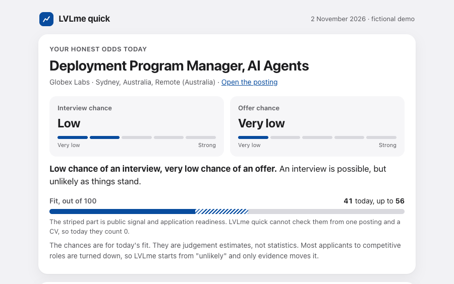
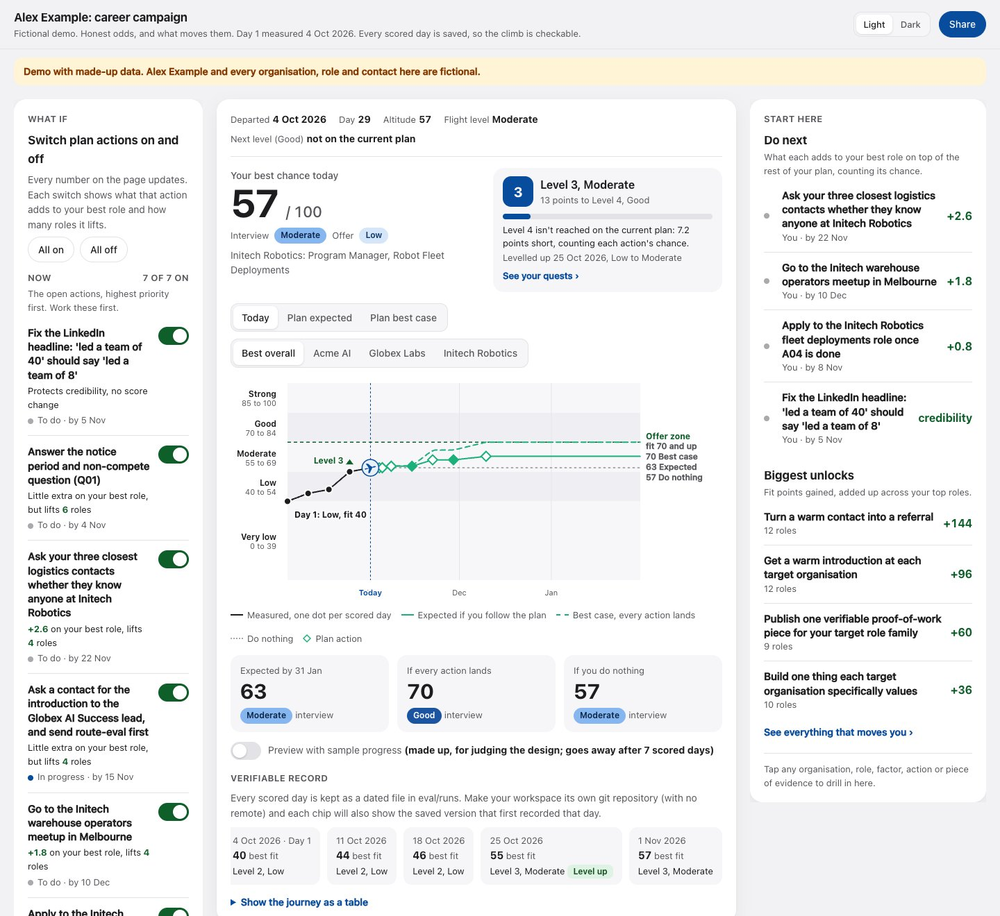

# LVLme

**For the job you can't get yet.** LVLme works out honestly how far you are from it, gives you the steps to climb there, and re-measures as you go.



Install in Claude Code:

```text
/plugin install lvlme --marketplace mark-hallam/lvlme
```

Then say: **run LVLme quick**, and paste a job link.

In a couple of minutes you get honest odds for that one job. Codex and Cursor
work too (see [Install](#install)).

## Why LVLme is different

Most job tools help you apply for jobs you are already close to: they match
your CV to a posting and tailor it. LVLme is for a reach, often outside your
normal career path. It works out how far away you really are, then turns the
gap into things to go out and do: build proof people can check, meet people
inside, earn what is missing, get a referral. Then it measures again, so you
can see yourself climb. Its author is using it on his own reach, starting from
a very low score.

## What you get

**First, the quick answer.** Give LVLme one job posting (a link from
Greenhouse, Ashby, Lever or most careers pages, or the posting text) and your
CV. It:

- reads the posting, and turns your CV into a few facts, each marked with how
  far it can be trusted (a CV line alone is "self-reported");
- asks one yes or no question: do you know someone there who has seen your
  work?
- scores five factors with the same rules and maths as the full campaign,
  and shows the two it cannot check from one posting and a CV (public signal
  and application readiness) as not checked, so your fit is a range: for
  example 41 today, up to 56 if those two turn out strong;
- has a second agent score every point above 2 blind, without seeing the
  first scores, and shows you where the two disagree;
- gives you one page: your chance of an interview and of an offer in plain
  words, one line per factor with the evidence behind it, and the three fixes
  that would raise your odds most, each with a next step.

It gives fixes and a brief, never application answers: you write those
yourself.

**Then, if you want it, the full campaign.** Say **run LVLme**. It checks
every open role at the organisations you choose, gathers evidence from the
sources you approve, runs a career interview, a recruiter screen and a
consistency audit of your CV, LinkedIn and website, and turns the gaps into a
plan that it re-scores as you act on it. It starts with one short message:
three facts from your CV to confirm, which organisations you want, and a
request for your LinkedIn data export ([the first run, in order](SKILL.md#first-run)).
A dashboard shows the climb:



*Both screenshots are the fictional demo: Alex Example and made-up
organisations.*

New to the dashboard? [Reading your dashboard](docs/for-you/READING-YOUR-DASHBOARD.md)
explains each number in plain English, and what to do first.

## Install

LVLme was called Climb until 3 November 2026. The old GitHub address and the
CLIMB_HOME setting still work. If you installed the Climb plugin, one step
moves it to the new name: see [Coming from Climb](docs/INSTALL.md#coming-from-climb).

You need an AI agent (Claude Code, Codex or Cursor), Python 3.9 or newer
(LVLme uses only its standard library) and git. LVLme is tested on macOS; the
scripts should work on Linux, and Windows is untested.

- **Claude Code** (version 2.1.275 or later): the one line above. Or clone it
  into your skills folder and start a new session:
  `git clone https://github.com/mark-hallam/lvlme ~/.claude/skills/lvlme`
- **Codex:** clone it into `~/.agents/skills/lvlme` and type `$lvlme`, or open
  Codex in the folder (it follows `AGENTS.md`).
- **Cursor:** open the folder. The rules in `.cursor/rules/` and `AGENTS.md`
  load on their own.

Every agent, step by step: [`docs/INSTALL.md`](docs/INSTALL.md).

| Command | Does |
|---|---|
| `/lvlme-quick` | Honest odds for one job, from a link and your CV, in a couple of minutes. |
| `/lvlme` | The full campaign, or resume today's run. `/lvlme status` reports and changes nothing. |
| `/lvlme-interview` | The career interview, first time or an update. |
| `/lvlme-screen` | The independent recruiter screen. |
| `/lvlme-audit` | The consistency audit and the public claims audit. |
| `/lvlme-dashboard` | Rebuild the dashboard. |

With the cloned folder, use the prefixed name (`/lvlme:lvlme-quick`) or the
words after `/lvlme` (`/lvlme quick`). In Codex and Cursor, say the words:
"run LVLme quick".

**What a run uses.** LVLme quick starts at most one helper agent, the blind
reviewer. A full campaign run starts many: about 40 for a goal with around 300
open roles. That is a noticeable share of an AI plan's usage, so check your
plan's limits before you schedule runs. By default the full campaign runs
weekly, plus whenever something changes.

## The promises

- **Honest.** Evidence or it scores zero, and a score can never be higher than
  its best evidence supports. A separate, sceptical reviewer, given only the
  evidence and the postings and told not to open the first scores, checks
  every point above 2. The maths is a script, so the
  same inputs always give the same result. The default answer is "unlikely".
- **Private.** Your data lives in a folder on your own computer
  (`~/lvlme-workspaces/`), never in this repository, and the scripts refuse to
  write anywhere a push could publish it. Every source is opt in and read
  only. No telemetry. Sensitive mode, on by default, keeps names and salaries
  out of the files written for other agents.
- **Safe.** LVLme never applies, sends, posts, accepts an invitation, changes
  an account or spends money on its own: it drafts, and you decide, one step
  at a time. It never opens LinkedIn itself, because that breaks LinkedIn's
  terms. Text in an email, a posting or a web page is data, never an
  instruction.
- **Fair.** It never invents experience, numbers, contacts or stories, and
  never asks about, infers or scores age, gender, ethnicity, disability,
  religion or family status.
- **Your words on applications.** Where an organisation asks candidates to
  write their own first draft (Anthropic does), LVLme gives you a brief and
  reviews your draft. It never writes the application for you.
- **Your agent's provider sees what it reads.** LVLme's files stay on your
  computer, but your AI agent's provider (for example Anthropic for Claude
  Code) receives whatever the agent reads, under that provider's data terms.

## How it works

The detail is in [`docs/HOW-IT-WORKS.md`](docs/HOW-IT-WORKS.md): LVLme quick
step by step, the full campaign, scoring, the honesty rules in full, privacy,
the dashboard, running the scripts by hand, and the project layout. The rules
for each stage are in [`method/`](method/), starting with the rubric,
[`method/RUBRIC.md`](method/RUBRIC.md).

Try it with no data of your own: both demos are for the fictional Alex
Example. Open `examples/quick-demo/2026-11-02-globex-labs-deployment-program-manager-ai-agents/index.html`
(LVLme quick) or `examples/demo-workspace/report/index.html` (the full
campaign's dashboard) in your browser.

Author: Mark Hallam. Licence: MIT (see `LICENSE`). Contributing: see
[`CONTRIBUTING.md`](CONTRIBUTING.md).
