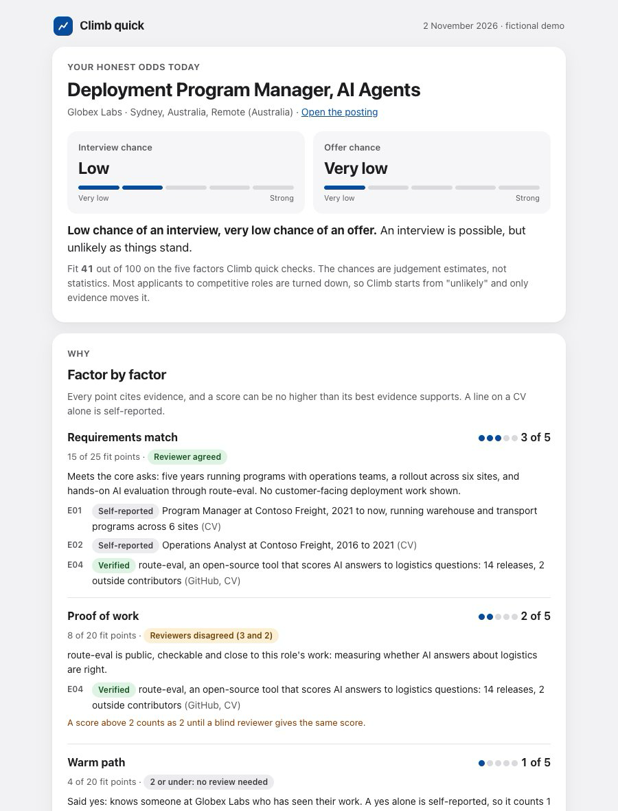
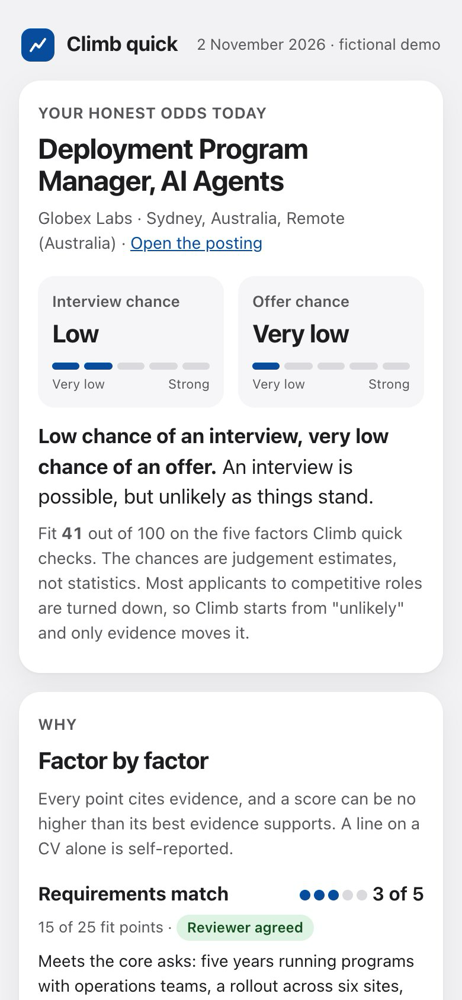
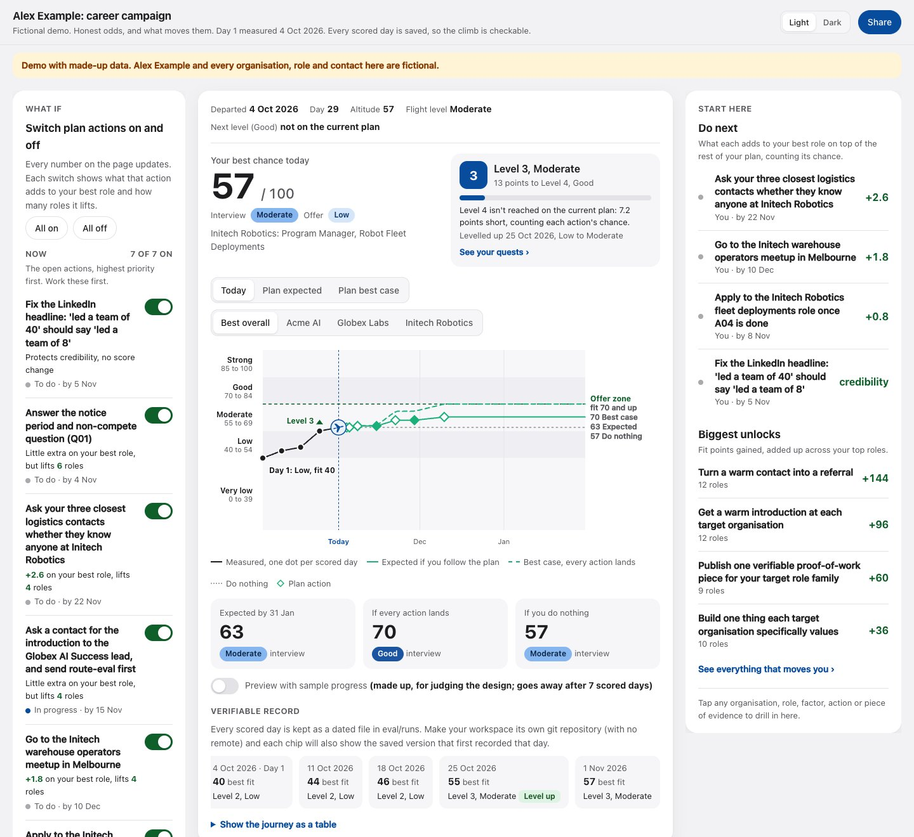
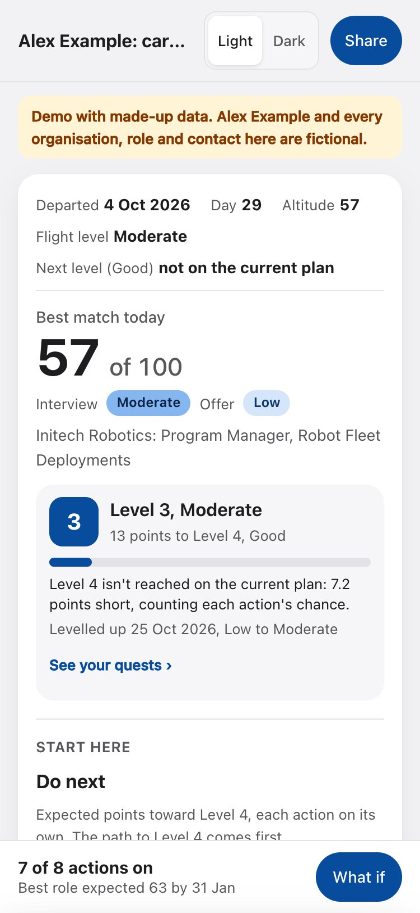

# How Climb works

The README is the front door. This page holds the detail: Climb quick step by
step, the full campaign, the honesty rules, privacy, the dashboard, the demo,
running the scripts by hand, and where everything lives.

Climb runs on your own computer, through an artificial intelligence (AI) agent
such as Claude Code, Codex or Cursor. The agent does the judging; the Python
scripts only do the arithmetic, so without an agent every role scores zero.

## Climb quick: one job, about five minutes

Say "run Climb quick" (or `/climb-quick`) and give two things: one job posting
link, or the posting text, and your CV (short for curriculum vitae: a file, or
pasted text). The steps are in
[`skills/climb-quick/SKILL.md`](../skills/climb-quick/SKILL.md):

1. **The posting.** `scripts/quick_posting.py` reads Greenhouse, Ashby and
   Lever links through their public job-board APIs (application programming
   interfaces, the feeds job boards publish). Any other link is fetched once as
   a public page, using the job details many careers sites build into the page
   when they are there. If the page gives too little text (many sites draw
   the page in the browser), you paste the text instead. LinkedIn links are
   refused: Climb never opens LinkedIn.
2. **Your evidence.** The agent turns your CV into a few evidence items, each
   marked on the verification ladder (below). A line on a CV alone is
   self-reported. If your CV links to public work, such as a repository, the
   agent may open up to three such links, read only, to check them.
3. **One or two questions.** Always: do you know someone there who has seen
   your work and would vouch for you? (yes or no). Work rights only if your CV
   and the posting do not settle them.
4. **The judging.** Five of the seven factors: requirements match, proof of
   work, warm path, organisation-specific edge, and eligibility and logistics.
   Public signal and application readiness need more than one posting and a
   CV, so they count 0 here, as anything without evidence does.
5. **The blind second opinion.** For every score above 2, one fresh reviewer,
   given only the rubric, your evidence and the posting, scores it for itself.
   If the two agree, the score stands. If they disagree, the disagreement is
   logged and the score counts as 2, the rule for a dispute still waiting for
   its tie-break. The full campaign runs that tie-break.
6. **The maths.** `scripts/quick.py build` scores with the campaign's own code
   (`scripts/score.py`): the evidence caps, the review cap, the hard
   requirement and eligibility rules, the fit and the bands.
7. **The fixes.** The agent proposes fixes; the script measures each with the
   same maths, caps it at what can realistically change in a few months (the
   dashboard's projection caps), and keeps the three that add the most fit
   points. Each comes with one concrete next step.

The result is a one-page `index.html` and a short message:





Climb quick gives fixes and a brief, never application answers. Some
employers publish guidance on how candidates may use AI when applying; check
theirs, and write your answers in your own words.

Its files live in `~/climb-workspaces/quick/<date>-<organisation>-<title>/`,
never in this repository. To go deeper, say "run Climb": the full campaign
below.

The demo is in `examples/quick-demo/`: the fictional Alex Example asks about a
made-up Globex Labs posting. Rebuild it offline with
`python3 examples/build_quick_demo.py`.

## The full campaign

It answers one question honestly: how likely am I to land this kind of role at
these organisations, and what would raise my odds? Then it runs the campaign
with you.

1. **Your honest odds**, for every open role that fits your goal, from
   evidence, not vibes. Most people start "Very low". That is the point: you
   see the real starting line.
2. **Why**, factor by factor, with every point traced to a source.
3. **A campaign** that turns the gaps into a short, prioritised list of
   actions, re-scored on a schedule, so your effort goes where it moves the
   number.
4. **A dashboard** that shows the climb: your measured Day 1, every scored day
   since, the level you are at, and the actions that take you to the next
   level.

Along the way it runs:

- **A career interview** that reads your documents first (your CV, your
  LinkedIn data export, your website), then asks only what they cannot answer.
- **Evidence gathering** from the sources you approve: email (read only),
  GitHub, the public web and press, public registers, and your files.
- **Market research**: open roles from public job boards, and sourced facts
  about each organisation.
- **A consistency audit**: do your CV, LinkedIn, website and any official
  forms say the same thing about the same facts?
- **A recruiter screen**: an independent recruiter persona reads your
  materials against real postings, the way a busy screener would.
- **Drafted fixes**: honest wording for anything overstated or mismatched,
  ready for you to apply.

The first example goal is getting hired at a frontier AI lab. The engine does
not care what the goal is: the target organisations, role types and weights
are all settings in one file. A new workspace starts with the example's
organisations; the interview replaces them with yours (or edit
`config.json`).

### A run, stage by stage

A run has ten stages: intake, evidence, market, judge and audit, review,
score, SWOT and TOWS (strengths, weaknesses, opportunities and threats, and
the strategies that combine them), plan and fixes, report, and a short
message to you. An agent that can start helpers does the independent work in
parallel: one helper per evidence source, one per organisation, judges in
batches, the audits and the recruiter screen at once. Then it joins the
results and passes four gates: findings are checked, the reviewer and the
recruiter screen are independent, nothing is scored before review, and
nothing public happens without your yes.

Runs are weekly, plus a run whenever something changes (an action done, new
evidence, a new export). Scores only move when evidence changes. Each run
saves one dated run file, so your progress is a record, not a claim. Details:
[`ORCHESTRATION.md`](ORCHESTRATION.md).

### What a run uses

Climb quick starts one helper agent, the blind reviewer, and only when a
score is above 2. A full run starts many helper agents: about 40 for a goal
with around 300 open roles (one role judge per batch, plus scouts and
reviewers). That is a noticeable share of an AI plan's usage, so check your
plan's limits before you schedule runs.

## How scoring works

Each open role is scored 0 to 5 on seven factors: requirements match, proof of
work, warm path (someone inside who vouches for you), organisation-specific
edge, public signal, eligibility and logistics, and application readiness.
Weighted together they give a fit score out of 100, which maps to a chance
band for an interview and for an offer (Very low, Low, Moderate, Good, Strong).
A referral moves the interview band up; a missing hard requirement moves both
down; a cold application caps the offer band at Low. The full rules are in
[`method/RUBRIC.md`](../method/RUBRIC.md).

## The honesty rules

Most career advice flatters. Climb is built to do the opposite.

- **Evidence or it scores zero.** Every point needs a source: a link, a file,
  an email, or your own answer to an interview question. A claim with no
  source counts as absent and becomes a "verify to unlock" question.
- **A verification ladder.** Evidence is graded `verified`, `corroborated`,
  `partially_verified`, `self_reported`, `unverified` or `contradicted`. A
  score can never be higher than its best evidence supports. An achievement
  only you have claimed supports at most 1 point out of 5; one that is only
  partly checked never supports more than corroborated evidence would.
- **A separate, sceptical reviewer.** A fresh agent, given only the rubric,
  the evidence and the postings and told not to open the campaign's scores or
  reasoning, scores every point above 2 for itself. In the full campaign,
  where it disagrees, a second fresh reviewer scores it too and the middle of
  the three stands, with every dispute logged. Until the review is done, the
  score counts as 2.
- **Helpers are checked, not trusted.** Helper agents return every finding
  with its source, tagged verified or unverified, and the lead agent opens the
  source of anything that matters before it counts.
- **The maths is a script, not a mood.** Judgements live in files. A
  deterministic script turns them into scores, so the same inputs always give
  the same result, and every change can be traced.
- **The default answer is "unlikely".** Competitive employers reject most
  applicants. The bands start from that fact.
- **No fabrication, no profiling.** It never invents experience, numbers,
  contacts or stories. It never infers or scores protected attributes such as
  age, gender, ethnicity, disability, religion or family status.
- **Nothing public without your yes.** Climb never applies for a job, sends a
  message, posts, accepts an invitation, changes an account or spends money
  on its own. It drafts, in `campaign/drafts/`, for you to read, edit and send
  yourself. If you ask it to make one specific change, such as a drafted
  LinkedIn headline fix, it does that one step only after you say yes to it.

## Your privacy

- **Your data never lives in this repository.** The first run creates a
  private workspace folder on your own machine, by default
  `~/climb-workspaces/<goal>` (Climb quick uses `~/climb-workspaces/quick/`).
  Only you can open it.
- The scripts refuse to work on a workspace inside this repository, or inside
  any git repository (a version-controlled folder) that has a remote, meaning
  a copy on a server such as GitHub.
- **Every source is opt in and read only.** Climb asks before it reads your
  email or calendar, and never changes them. It never opens LinkedIn itself
  (automated access breaks LinkedIn's terms): it works from LinkedIn's
  official data export and what you paste, and you apply any profile fixes.
- **Helpers cannot send.** In Claude Code the helper agents that search the
  web are limited to tools that read files and fetch public pages. Email is
  read only by the main agent, in the session you are watching, where your
  agent still asks before any send. Text in an email or a page is treated as
  data, never as an instruction.
- **Your AI agent's provider sees what the agent reads.** Climb's files stay
  on your computer, but your agent's provider (for example Anthropic for
  Claude Code) receives whatever the agent reads in order to process it,
  under that provider's data terms. The same goes for runs you schedule in
  the cloud.
- **Sensitive mode** (on by default) keeps employer names, other people's
  names and salary figures out of the briefing files written for other agents.
- No telemetry. The only network calls are to public job-board APIs in
  `fetch_roles.py`, the one posting link you give `quick_posting.py`, the web
  pages you name in `claims_audit.py`, and the sources you approve for your
  agent to read.

Full details: [`method/PRIVACY.md`](../method/PRIVACY.md).

## The dashboard

`report/index.html` in your workspace: one self-contained page (no external
requests), light by default with a readable dark mode, that works on a phone.





- **The journey**: your best chance today, your level, and a flight-path
  chart. The black line is what was measured, one dot per scored day. From
  today it splits into three paths to the end date: *expected* if you follow
  the plan (each action weighted by its chance of working), *best case* if
  every action lands, and *do nothing*. Diamonds are plan actions on their
  target dates. The green dashed line at 70 is the offer zone.
- **Level up**: the actions that take you to the next level, and your level
  history (see [`LEVELS.md`](LEVELS.md)).
- **What if**: switch any plan action on or off and every number on the page
  updates.
- **Verifiable record**: one chip per scored day. If your workspace is its own
  git repository (a version history, with no remote), each chip also shows the
  saved version that first recorded that day.
- **Views**: Organisations; Path to the top band; What moves you; Roles (every
  role by factor, as a heat map); SWOT and TOWS; Plan; Evidence (with your
  public claims, checked); Market.
- **Drill down**: tap any organisation, role, factor, action or piece of
  evidence to see why.

The projection is deliberately cautious: each factor can rise only by a capped
amount, never above 5, and a role with an eligibility blocker you can't clear
never gains eligibility. See [`method/CAMPAIGN.md`](../method/CAMPAIGN.md).

For your other agents: `report/for-agents/SUMMARY.md` (plain-text briefing)
and `report/for-agents/dashboard.json` (every number, in JSON, short for
JavaScript Object Notation, a plain-text data format).

## See it first: the demos

`examples/demo-workspace/` is a complete, built example for a **fictional**
person, Alex Example, who targets three made-up organisations (Acme AI, Globex
Labs and Initech Robotics). Nothing in it describes a real person or a real
company's hiring. `examples/quick-demo/` is the same person's Climb quick
answer for one made-up posting.

Open `examples/demo-workspace/report/index.html` in your browser, or rebuild
it:

```bash
python3 scripts/build_dashboard.py --workspace examples/demo-workspace
```

Rebuild the whole demo from its inputs (offline):

```bash
python3 examples/build_demo.py
python3 examples/build_quick_demo.py
```

## By hand, in a terminal

Climb quick:

```bash
python3 scripts/quick.py new --posting "https://jobs.lever.co/example/0000" --cv ~/Documents/cv.pdf
# the agent's part: profile/evidence.json and eval/quick.json in the folder it prints
python3 scripts/quick.py review-items --folder <folder>   # what the blind reviewer scores
python3 scripts/quick.py build --folder <folder>          # index.html, result.json, message.md
```

The full campaign:

```bash
python3 scripts/init.py --goal "Frontier AI labs" --example frontier-ai-labs   # private workspace from the example
export CLIMB_HOME=~/climb-workspaces/frontier-ai-labs
python3 scripts/fetch_roles.py                        # open roles from public job boards
python3 scripts/network_map.py --csv ~/Downloads/Connections.csv   # optional: needs your LinkedIn export
python3 scripts/claims_audit.py https://your-site.example/about
python3 scripts/score.py                              # deterministic scoring
python3 scripts/build_dashboard.py                    # report/index.html
python3 scripts/validate.py                           # checks every file
```

Between `network_map.py` and `score.py` there is judgement work: the
interview, recording evidence, the audits, and judging each role against the
rubric. The method files explain each step, and
[`method/RUNBOOK.md`](../method/RUNBOOK.md) gives the full run order.

Every campaign script takes `--workspace PATH`. Without it, scripts use
`$CLIMB_HOME`, or the only folder inside `~/climb-workspaces/`.

## Commands

| Command | Does |
|---|---|
| `/climb-quick` | Climb quick: honest odds for one posting, from a link and your CV. |
| `/climb` | Run Climb, or resume today's run. `/climb status` changes nothing and reports. |
| `/climb-interview` | The career interview, first time or an update. |
| `/climb-screen` | The independent recruiter screen. |
| `/climb-audit` | The consistency audit and the public claims audit. |
| `/climb-dashboard` | Rebuild the dashboard. |

With the plugin, these short names work. With the cloned folder, use the
prefixed name (`/climb:climb-interview`) or the words after `/climb`
(`/climb interview`). In Codex and Cursor, say the same words: "run the Climb
interview", and so on. Install details for every agent:
[`INSTALL.md`](INSTALL.md). Climb is tested on macOS; the scripts should work
on Linux, and Windows is untested.

## Project layout

```
SKILL.md  AGENTS.md  README.md  LICENSE  CONTRIBUTING.md
.claude-plugin/  plugin.json and marketplace.json (Claude Code)
skills/     the /climb-quick, /climb-interview, /climb-screen, /climb-audit, /climb-dashboard commands
agents/     subagent briefs: evidence-scout, market-scout, role-judge, reviewer, recruiter-screen
.cursor/rules/  Cursor rules
method/     the rules for each stage (rubric, interview, intake, audits, review, campaign, privacy, runbook)
schemas/    JSON Schema files (rules for every workspace file)
scripts/    init, fetch_roles, network_map, claims_audit, consistency_audit,
            score, build_dashboard, validate, quick, quick_posting
templates/  the workspace skeleton that init.py copies, and agent prompts
docs/       INSTALL.md, HOW-IT-WORKS.md, ORCHESTRATION.md, LEVELS.md, DESIGN.md
examples/   demo-workspace/ and quick-demo/ (fictional), build_demo.py, build_quick_demo.py
tests/      offline tests: python3 -m unittest discover -s tests
```

Your workspace (private, outside this repository) looks like this:

```
config.json                goal, targets, role types, locations, weights, privacy
intake/answers.md          your interview answers
intake/sources/            exports you supply (LinkedIn data, résumé)
profile/                   evidence.json, network.json, claims-audit.json
market/                    roles/latest.json, roles/snapshots/, orgs.json
eval/                      judgements, profile dimensions, SWOT, outlook, runs/
campaign/                  plan.json, inbox.md, drafts/, weekly/
report/                    index.html, for-agents/
```

## Not in version 0.1

Automatic LinkedIn scraping (it breaks LinkedIn's terms, so use the official
data export instead), automatic applying, salary negotiation, goals other than
jobs, and the Workable and SmartRecruiters job boards (enter those roles by
hand in `market/roles/manual.json`). Climb quick takes a posting from any
site, as a link when the page holds the text, or pasted.
