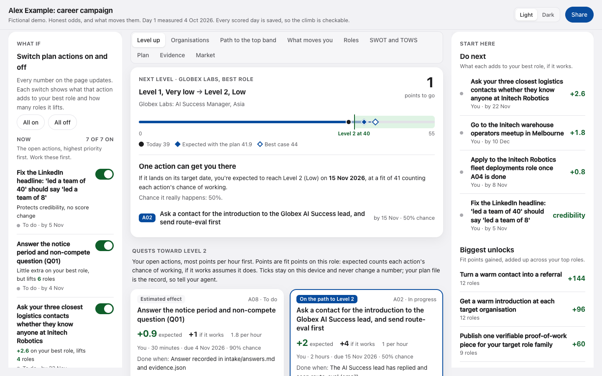

# Levels: what gets you to the next one

Status: added 2026-11-02. Code: `scripts/_levels.py` (the maths), `scripts/_levels_html.py`
(the first render of the view) and the `JS_LEVELS` block in `scripts/_dashboard_assets.py`
(the same maths in the page, so the switches can change it). Tests: `tests/test_levels.py`.

The dashboard always answers one question: **what, exactly, gets me to the next level?**
It also shows the progress already made, in a way anyone can check. Nothing on it is a
game score: every number is a fit point from the rubric or an effect from the plan.

## Where it shows

- **The level card**, top right of the journey: your level, the points to the next one,
  a bar, one line on whether the plan gets you there and by when, and your most recent
  level change. It follows the organisation selector above the chart.
- **The Level up view**, the first view under the journey (it opens by default):
  1. *Next level*: a track from your current level to the next, with today, the expected
     result of the plan and the best case marked, then the verdict (below).
  2. *Quests*: every open plan action as a card.
  3. *Progress you can trust*: the streak and the level history.
- **The verifiable record** chips under the chart now show each scored day's level, with a
  "Level up" or "Level down" tag when it changed, and the chart marks those days with a
  small triangle.
- **The action pane** (tap any action) has the same "Done? Tell your agent" button.
- **The agent files**: `report/for-agents/dashboard.json` has a `levels` block and
  `SUMMARY.md` has "Next level", "Quests", "Progress" and "When the person says an action
  is done" sections.

## What a level is

Levels are the fit bands from `method/RUBRIC.md`, numbered so progress is easy to say:

| Level | Band | Fit score |
|---|---|---|
| 1 | Very low | 0 to 39 |
| 2 | Low | 40 to 54 |
| 3 | Moderate | 55 to 69 |
| 4 | Good | 70 to 84 |
| 5 | Strong | 85 to 100 |

The level uses the fit score itself, before the rubric's referral and hard requirement
adjustments, so "points to the next level" is a plain distance on the 0 to 100 scale. The
chance bands shown elsewhere on the page still include those adjustments.

## The next level, worked out

For the role the journey follows (your best role, or the best role at the organisation
picked in the selector):

1. **Which actions can help.** Only open actions (to do, or in progress) that are switched
   on in the What if rail, and only those that raise at least one of this role's factors if
   they work. Done actions are already in today's score; dropped ones never count. Parked
   actions (status `later`) start switched off and count only once switched on in the rail.
2. **The smallest set.** Every combination is tried, smallest first, using the same
   projection as the journey chart: actions apply in target date order, each effect is
   weighted by the action's chance of working, no factor rises more than the plan's
   `projection_caps` over today or above 5, and a role whose eligibility blocker cannot be
   cleared never gains eligibility. The first size at which some set reaches the next
   level wins. Ties go to the set that gets there first, then the one with the fewest
   hours, then the higher fit. Plans with more than 14 helpful actions use a quick search
   instead (the most fit per hour first, then anything it can do without is dropped), and
   the page says so.
3. **The date.** The day the level is reached if those actions land on their target dates.
   Actions with no target date count at the end of the plan. If doing everything switched
   on gets there sooner, the page says that too.
4. **The chance it really happens.** The expected path is an average, so the page also
   gives the chance the set actually crosses the line: every works or fails outcome of the
   set is projected, and the chances of those that reach the level are added up, treating
   each action's chance as independent.

**When no set gets there,** the page says so plainly ("Not reachable on the current
plan") and shows:

- how far the whole plan falls short, counting each action's chance;
- the best case, if there is one: the smallest set that would reach it if every action in
  it works, its date and the chance of that;
- **what is missing**: for each factor, the room left on this role within the caps after
  the plan, in fit points, and whether any open action covers it. A factor with room and
  no action is where a new action should go;
- if even the caps cannot reach the level (for example years in a similar role, which the
  default caps hold still), it says the role tops out below it.

## Quests

Each open action is a card with: its id and status, tags, the title, **points toward the
next level**, owner, effort, due date, chance, and what proves it done.

- **Expected**: what it adds to this role's fit, weighted by its chance of working, on top
  of the other switched-on actions. This is the same number as the What if rail.
- **If it works**: what it adds when it does work (its best case).
- **Per hour**: expected points divided by effort hours. Cards are sorted by it, highest
  first.
- Tags: **On the path to Level N** (in the smallest set, also outlined in the accent
  colour), **Needed for the best case** (when no set gets there on expected odds),
  **Estimated effect** (the plan gave no effects, so they were estimated from
  `expected_points`), **No movement in N runs** (a stalled experiment), and **Switched off
  in What if**.
- An action that changes no score says "Protects credibility, no score change"; one that
  helps other roles but not this one says "No points on this role".

## Progress you can trust

- **Level history**: one row per scored day (newest first) from the dated files in
  `eval/runs/`, with the level of the role the journey follows and a "Level up" or "Level
  down" tag when the band changed. Level downs are shown as honestly as level ups.
- **Streak**: how many scored days in a row, up to the latest, showed real progress on any
  role. Real progress is at least one of:
  - a role open on both days gained fit (a role that just opened does not count);
  - evidence that is verified or corroborated had a source checked since the previous
    scored day (its `checked_on` date, or `added_on` if no source has one);
  - a plan action was finished since the previous scored day, with `done_evidence`.
  Day 1 is the measured start and never counts. Each row of the history says which of
  these happened that day.

## Marking a quest done without breaking the source of truth

The dashboard is a static file and `campaign/plan.json` is the record, so the page never
claims an action is done.

- **Done? Tell your agent** copies a ready instruction, for example
  `Mark action A07 done ("Ask your three closest logistics contacts ..."). Evidence: <paste a
  link, file path or email reference>. Done when: ...`. The person adds the evidence and
  pastes it to their agent. If the browser blocks copying, the text appears on the card to
  copy by hand. Without JavaScript the instruction is printed on each card.
- **Pending on this device** is an optional tick kept in the browser's local storage
  (`climb-pending:<report title>`). It only adds a "Pending: tell your agent" tag. It never
  changes a number, is never sent anywhere, and disappears once the action is no longer open.
- The agent running the campaign then sets `status`, `done_evidence` and `finished_on` in
  `campaign/plan.json` (done needs a link, a file or an email reference, as
  `method/CAMPAIGN.md` says). Any other agent appends the message to `campaign/inbox.md`.

## For agents: the `levels` block in dashboard.json

| Field | What it holds |
|---|---|
| `best_role`, `per_org.<org>` | `level`, `band`, `points_to_next`, `next_level_starts_at`, `reachable_on_expected_odds`, `whole_plan` (expected and best case fit, and the date the level is reached), then either `smallest_set` (actions, `level_reached_on`, `fit_expected`, `chance_it_happens`, `exact_search`) or `best_case_set` and `missing` (`points_short`, `ceiling_within_caps`, `room_by_factor`). |
| `quests` | Every open action for the best role, sorted as on the page, with `points_expected`, `points_if_it_works`, `points_per_hour`, `on_path_to_next_level`, `needed_for_best_case` and the `tell_your_agent` text. |
| `level_history`, `streak`, `progress_days` | The history and streak described above. |

These use every open action switched on (the page's default). Sensitive mode scrubs them like
the rest of the file.

## Honesty rules

1. No experience points, badges for effort, or any number not derived from the rubric, the
   scored runs or the plan.
2. "Gets you there" means on expected odds (each action weighted by its chance), within the
   projection caps. The best case is always labelled as needing every action in it to work.
3. The page says plainly when the next level is not reachable, and shows what is missing.
4. Level downs and days without progress are shown, not hidden.
5. A tick on the page is never treated as done. Only the plan file, with evidence, is.
6. The level view, the level card and a static summary of the key numbers (best chance,
   level, outlook, top actions by priority, best role at each organisation) are rendered into the
   HTML file, so they read the same with JavaScript off. The page script hides the static
   summary once it has drawn the live page.

## Known limits

- Chances are treated as independent. Two actions that depend on the same person are not.
- The expected path averages outcomes; a level "expected by" a date still depends on the
  actions working, which is why the chance it really happens is shown beside it.
- An evidence item's check date is the latest `checked_on` among its sources, so
  re-checking an old source counts as newly checked evidence on that day.
- The streak counts progress on any role; the level history follows the selected one.
- Without JavaScript the page shows the static summary, the level card and the Level up
  view. The journey chart, the What if switches and the other views still need JavaScript.
