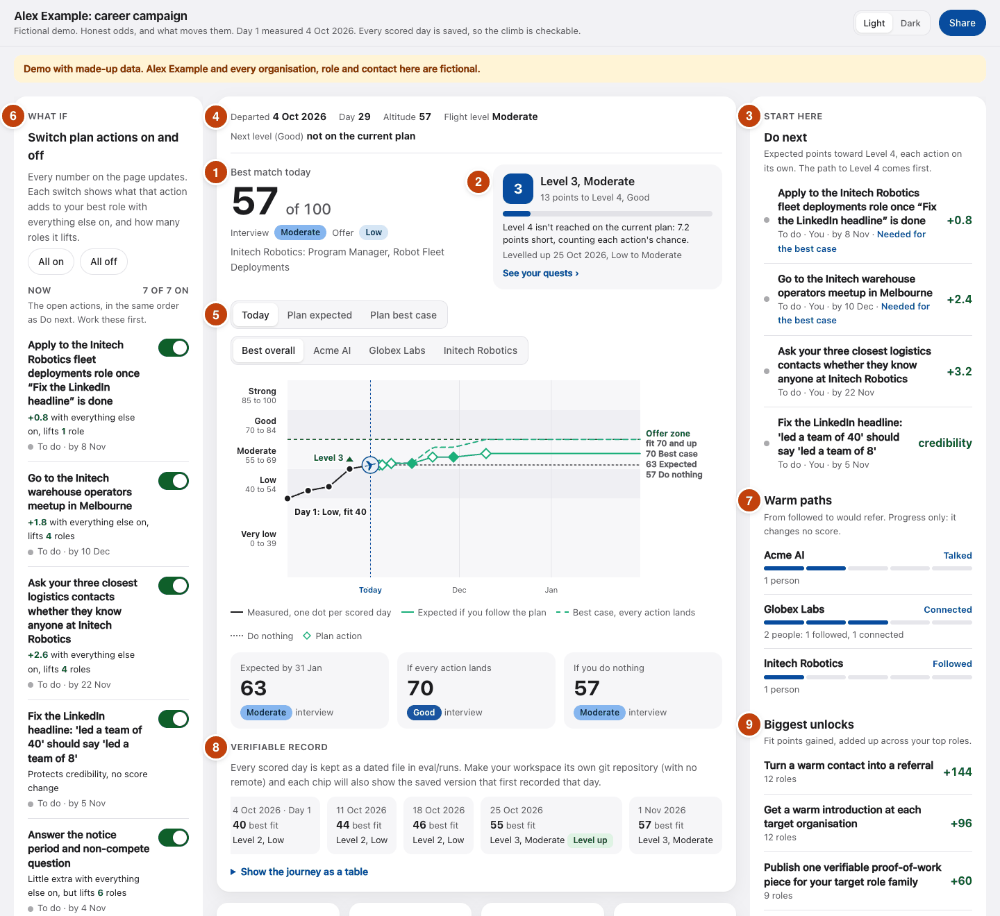

# Reading your dashboard

Your dashboard is one page in your private LVLme folder (your workspace):
`report/index.html`. Your agent gives you the command to open it after each
run. It answers three questions: how far am I from the job, what should I do
next, and is it working?

Nothing on it is a game score. Every number comes from the evidence about
you, the job postings or your plan. The picture and the numbers below are
from the fictional demo, Alex Example, so you can open the same page and
follow along: `examples/demo-workspace/report/index.html`.

## Your first two minutes

1. Read the big number (1) and the two chance words under it.
2. Read your level card (2): the points to the next level, and whether your
   plan gets you there.
3. Do the first action in **Do next** (3; on a phone it sits under the level
   card). That is enough.

## What each part means

### 1. Best match today

**57 of 100** in the demo. It says how well your evidence fits your best
role. It is not a percentage chance. LVLme scores seven factors, such as how
well you meet the requirements, your proof of work and whether someone inside
knows your work, each from 0 to 5, and weights them into this one number. A
separate, sceptical reviewer checks every factor scored above 2. One point
apart, the reviewer's score counts; further apart, a tie-break decides.

Your chances are the words under it: **Interview** Moderate and **Offer** Low in the demo. They run Almost none, Very low, Low, Moderate, Good, Strong. They are
careful judgements, not statistics.

### 2. The level card

Your fit, put into five levels:

| Level | Name | Fit |
|---|---|---|
| 1 | Very low | 0 to 39 |
| 2 | Low | 40 to 54 |
| 3 | Moderate | 55 to 69 |
| 4 | Good | 70 to 84 |
| 5 | Strong | 85 to 100 |

"13 points to Level 4, Good" is the plain distance to the next level. The
line under the bar says whether your plan gets you there, and by when. In the
demo the whole plan is expected to fall 7.2 points short. That is useful, not bad news: it means the plan needs a new action. **See your quests** opens the full list.

### 3. Do next

Your top four actions, best first. The ones on the path to your next level
come first. The green number, such as +0.8, is how much that one action is
expected to add to your best fit, counting its chance of working. Two actions
that help the same thing overlap, so their points do not simply add up. An
action marked **credibility** fixes something that could hurt you, such as an
overstated claim, without changing a score.

### 4. The flight strip

**Departed** is the day LVLme first measured you, Day 1. **Day** counts from
there. **Altitude (fit)** is your fit today on the role the chart follows, and
**Flight level (chance)** is the name of its level. **Next level** gives the date your
plan is expected to get you there, or says "not on the current plan".

### 5. The flight path

The black line is what was measured, one dot per scored day. From today it
splits three ways: the solid green line if you follow the plan, the dashed
green line if every action works, and the dotted line if you do nothing. The
diamonds are your plan's actions on their target dates. The dashed line at 70
marks the **Offer zone**.

The buttons above the chart show your numbers for **Today**, **Plan
expected** or **Plan best case**, and for your **Best overall** role or one
organisation. The three cards under the chart sum it up: where the plan is
expected to take you, where you get if every action lands, and where you
stay if you do nothing.

### 6. What if

Switch any action off to see what it is worth: every number on the page
updates. It changes nothing in your files. On a
phone, tap the **What if** button at the bottom of the screen.

### 7. Warm paths

How far your contacts at each organisation have come, from followed to would
refer. It shows progress only. Your score moves when there is evidence, such as someone agreeing to refer you.

### 8. Verifiable record

One chip for each scored day, with your best fit and level that day. Each
scored day is saved as a dated file in your workspace, so anyone you show can
check the climb. A level down shows as plainly as a level up.

### 9. Biggest unlocks

The kinds of moves that would lift the most roles. These numbers are added up
across your top roles, so +128 across 11 roles is about 12 points on each role, not 128 on one.

## Further down the page

Under the verifiable record, four tiles count your **Best role fit**, the
**Average of your top 5** roles, the roles that give you a low interview
chance or better, and the **Roles open to you**. Under What if,
**Campaign progress** counts what you have done against your plan's targets,
such as warm introductions and applications.

Below them is a row of tabs. **Level up** opens first: your next level
in detail, **What is missing** when no plan reaches it (a factor with room
left and no action yet is where a new action should go), your quests, and
**Progress you can trust** (your run of scored days with real progress, and
your level history).

The other tabs: **Organisations** (the outlook at each one), **Path to the
top band** (what a fit of 85 would take), **What moves you**, **Roles** (each
role, factor by factor), **SWOT and TOWS** (your strengths, weaknesses,
opportunities and threats, then the moves that pair them up), **Plan** (every
action, with **Badges** that unlock when an action is done, with evidence),
**Evidence** (what LVLme knows about you and how far each item can be
trusted) and **Market** (the open roles). Some tabs appear only once that
work has been done. Tap anything on the page to see why.

## When you finish an action

1. Tap the action, then **Done? Tell your agent**. It copies a short message.
2. Add your evidence: a link, a file or an email.
3. Paste the message to your agent.

Your numbers move on the next run, once the evidence is in. The
**Pending on this device** tick is only a reminder for you. It never changes
a number and is never sent anywhere.

## Good to know

- The page only shows. It never applies, sends or posts anything: your agent
  drafts, and you decide.
- **Share** makes a card with three numbers (Day 1, today and projected) and
  no names of organisations or people. Nothing is posted unless you post it.
- If a number did not move after you did something, the evidence is probably
  not in yet. Tell your agent.
- The detail behind every rule: [How it works](../HOW-IT-WORKS.md#the-dashboard)
  and [Levels](../LEVELS.md).
